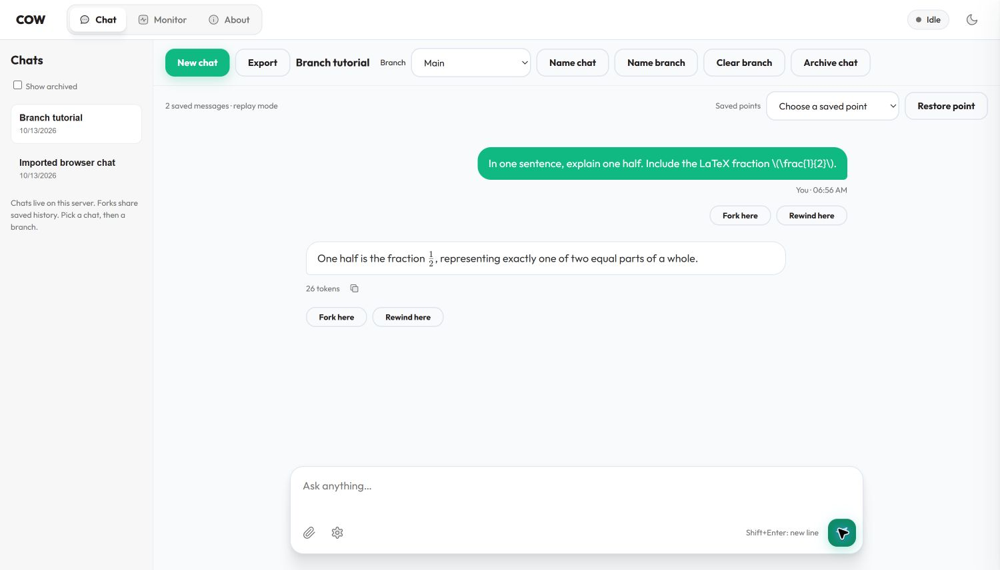
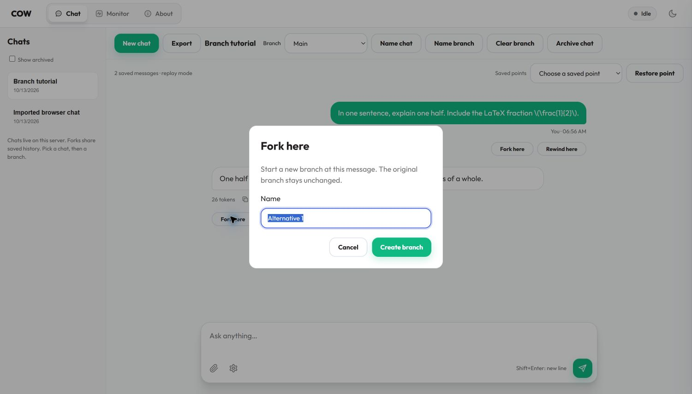
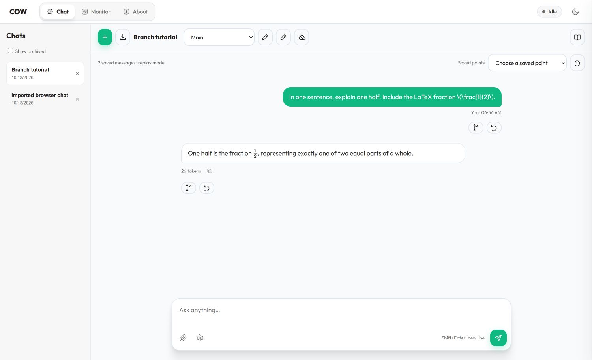

# Use chats and branches in COW

First, follow [Start here](START_HERE.md) to install and open the app.
The sample app has the same controls. It gives a fixed answer, not an AI answer.

The pictures in the steps below use **teaching mode**, which shows words beside
the icons. To turn it on, click the small **open book** above the chat. Hold the
pointer over any icon for about one second to see its name. Click the book again
to use the compact view. The buttons do the same things in both views.

## Three words to know

- A **chat** is a named conversation in the list on the left.
- A **branch** is one path through a chat. Each new chat starts with **Main**.
- **Fork** means start another path from a message. Both paths keep the earlier messages.

## Start a chat

1. Click **New chat** above the messages.
2. Type a name, such as `Math homework`.
3. Click **Create chat**.
4. Type a question in the box at the bottom.
5. Click **Send**. Wait for the answer to finish.

The chat stays in the list. Click its name to open it again.
Completed messages are saved on the server. You do not need to click a Save button.
**Export** downloads a Markdown text copy of the selected branch.

## Try two different paths

1. Find the last answer you want both paths to share.
2. Click **Fork here** below that message.
3. Type a name, such as `Pizza example`.
4. Click **Create branch**.
5. Ask a different question. For example: `Explain this with a pizza.`
6. Use the **Branch** list above the messages. Select **Main**.

Main still has its original messages. The pizza question belongs to the new branch.
Select `Pizza example` to return to that path.
You can fork from a user message or an answer. Wait for an answer to finish first.

## Go back, clear, or hide

- **Rewind here** returns the selected branch to that message. Confirm with **Restore point**.
- **Clear branch** empties only the selected branch. It does not erase its saved history.
- To undo a clear or rewind, choose the old point in **Saved points**, then click **Restore point** and confirm.
- The **×** beside a chat hides it from the normal list. Check **Show archived**
  to find it again. Click its return arrow to put it back in the normal list.
- **Name chat** and **Name branch** change labels. They do not change messages.

These actions do not undo things a tool did outside the chat, such as writing a file.

## Show an equation

1. Ask `Show one half as a LaTeX fraction.`
2. Open **Sampling and thinking** beside the message box.
3. Turn on **Render math**.
4. Choose **KaTeX** or **MathJax** in **Math viewer**.

The equation display changes immediately. It does not ask the model again.
Turn Render math off to see the original text.

## Where the chat lives

**SQLite** is a small database stored in a file. It comes with Python; you do not
need to install a database server. The sample uses
`context-cow-data/sample.chats.sqlite3`. A configured model server uses a
`.chats.sqlite3` file beside its configuration unless `chat_database` selects another path.
Keep this file private: it contains messages, attachments and tool results.
Stop the server before copying the database and its companion files for a backup.

This interface currently says **replay mode**. It sends the selected saved
history to ordinary serving. The experimental GPU COW checkpoint runners are
separate; these buttons do not yet select native GPU snapshots.

Ordinary serving can still reuse its prompt and conversation checkpoints when
those caches are enabled. Archive keeps messages, files and tool results in
SQLite. New requests on an archived chat do not save conversation checkpoints.
Previously parked checkpoints leave the native cache through its normal eviction
policy; archive cannot immediately remove one chat's old native cache entries.

Screenshots and executed checks are in
[the interface results](results/chat-workspace-20261013/).

## The compact interface

These are the same controls you learned above, with the words hidden:

| Old label | What to look for |
|---|---|
| New chat | Plus sign |
| Export | Down arrow into a tray |
| Name chat | Pencil beside the chat title |
| Name branch | Pencil beside the branch list |
| Fork here | Arrow that splits into two paths below a message |
| Rewind here / Restore point | Curled arrow |
| Clear branch | Eraser |
| Archive chat | × beside the chat in the list |
| Show control labels | Open book |

Hold the pointer over an icon to check its name. The browser's keyboard and
screen-reader labels are also available when the visible words are hidden.

